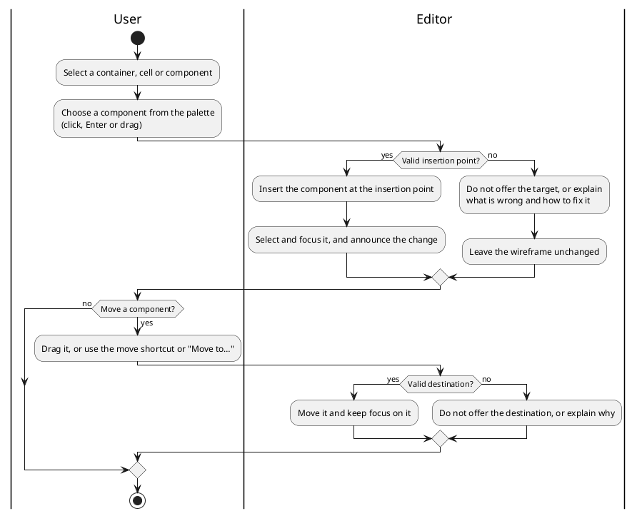
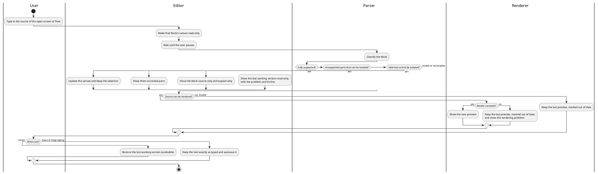
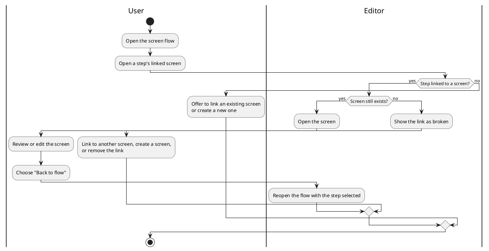
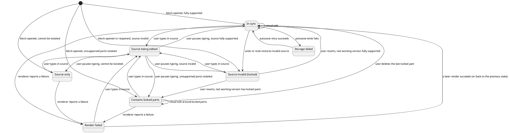

# PlantUML Wireframe and Screen Flow Editor: Product Specification

This document is the input to Speckit `/specify`. The product principles are in [constitution.md](constitution.md); the specification process, validation steps and required diagrams are in [setup.md](setup.md).

**Status of decisions.**

- Items marked **(decision)** are approved product decisions.
- Text added during specification review inside a decision section is marked *(added in review)*; it clarifies or corrects the decision on the basis of verified PlantUML behaviour or the constitution. The product owner confirmed these clarifications as a group on 2026-10-26 (OD-16).
- Items marked **Decided (OD-n)** were proposed by the review team and confirmed by the product owner on 2026-10-26; section 9.3 records each decision and the alternatives considered. Items marked **(A-n)** are working assumptions (section 9.2).
- PlantUML behaviour described as verified was checked by running the PlantUML command-line tool, version 1.2026.8. Statements about the in-browser build come from its package documentation; the build itself has not yet been run (section 3.5).

## 1. Product vision

Create a browser-based visual editor that enables business analysts and product owners to design low-fidelity user-interface wireframes using PlantUML Salt.

The application must allow users to construct interfaces visually using structured layouts and reusable UI components. The application manages the underlying Salt syntax and generates a valid, portable PlantUML Salt representation of the wireframe.

Users must also be able to describe how people move between screens using **screen flows**: PlantUML activity diagrams whose steps link to the wireframes in the same project. A project of screens plus a screen flow is exchanged as a single standard PlantUML file.

The product is intended for requirements analysis, stakeholder discussions, process and interface design, and communication of intended application behaviour to development teams.

**Reference product:** [mermaid-editor-wysiwyg](https://github.com/leejsinclair/mermaid-editor-wysiwyg) is the primary reference for **user experience only**: interaction patterns, panel layout, terminology and presentation of feedback. Its technical implementation, in particular its rendering pipeline, is not assumed to be reusable: Mermaid renders natively in the browser, whereas this product depends on an in-browser PlantUML build (section 3.5).

## 2. Target users and use cases

### Primary users

Business analysts and product owners who need to communicate screen layouts, capture requirements, discuss interface behaviour and validate proposed workflows before development. They are not expected to know PlantUML, Salt or activity diagram syntax.

### Secondary users

Developers, UX practitioners and other stakeholders who review, refine or implement the resulting wireframes.

### Core use cases

- Create a wireframe for a new application screen.
- Model an existing screen as a structured wireframe.
- Add and configure form fields, buttons, tables and other UI components.
- Arrange components into rows, columns, grids and nested sections.
- Reorganise a screen as requirements change.
- Demonstrate selected states, available options and representative data.
- Preview the rendered PlantUML Salt output.
- Export the project as PlantUML source, or screens and flows as images, for documentation, version control or further development.
- Open and edit an existing Salt document, including source produced outside the application.
- Create several screens within one project.
- Describe the flow between screens, including decisions (for example "credentials valid?") and alternative paths.
- Navigate from a step in a screen flow to the wireframe it refers to.
- Walk stakeholders through a user journey using the screen flow and its linked wireframes. In the initial release this is supported by flow-to-screen navigation with the editing panels collapsed (FR-015); a dedicated presentation mode is out of scope. Decided (OD-11).

### Terminology

These terms are used consistently in the user interface and in this document.

| Term | Meaning |
| ---- | ------- |
| Project | A set of screens, at most one screen flow and any other content, stored in the browser and exchanged as one `.puml` file. |
| Screen (wireframe) | One Salt diagram, written as one `@startsalt` block. |
| Screen flow | The project's activity diagram, whose steps may link to screens. |
| Step / decision / loop / lane | Elements of a screen flow (action, `if`, `repeat`/`while`, swimlane). |
| Block | One diagram in the project file (a screen, the screen flow or other content). Internal and specification term; user-facing text says "screen", "screen flow" or "other content". |
| Locked part | Valid content inside a screen or flow that the visual editor does not support. It is preserved exactly and edited only in source. |
| Other content | Diagram blocks that are neither a supported screen nor the screen flow (for example a sequence diagram, or Salt in an older format). Preserved exactly; edited only in source. |
| Last working version | The most recent source of a block that the editor could parse (section 4.1). |

## 3. Scope of the initial release

The initial release must deliver a reliable structured wireframe editor and a structured screen-flow editor, rather than attempting to reproduce every PlantUML capability.

### 3.1 Application workspace

Provide an integrated workspace containing:

- A **project panel** listing the project's screens (in file order, each with its status and the number of flow steps that link to it), the screen flow, and any other content. It is used to open, add, rename, duplicate (OD-15), reorder and delete screens, to add, open, rename and delete the flow, and to see blocks that cannot be edited visually (FR-015).
- A component palette organised by category (wireframe components when a screen is open; flow elements when the flow is open).
- A structured editing canvas built from HTML elements (see below), for the open screen or screen flow.
- An outline view showing the hierarchy of the open screen or flow, usable for selection, reordering and keyboard navigation.
- A contextual properties panel for the selected element; with nothing selected it shows the open screen's or flow's own properties.
- An optional, collapsible rendered-output pane showing the actual PlantUML render of the open block.
- A source view of the open block (Salt or activity).
- A project library for creating, opening and managing projects stored in the browser.
- Clear actions for importing, downloading, undoing and redoing work, and a visible autosave status.

The palette, outline, properties panel, source view and rendered-output pane are contextual to the screen or flow that is open. The interface should make the distinction between the editable workspace, the source and the rendered output clear; the rendered-output pane is labelled as read-only.

Every structural command (for example insert, delete, move to, wrap, unwrap, select parent, insert or delete row or column, open linked screen) is available as a visible, pointer-operable control for the current selection (for example a selection toolbar or context menu) that shows its keyboard shortcut. Drag-and-drop is never the only pointer method. A keyboard shortcut (for example F6) moves focus between the workspace regions (project panel, palette, canvas, outline, properties, source, preview). Keyboard shortcuts avoid combinations reserved by supported browsers (for example Alt+Left and Alt+Right) and by common screen readers, and the canvas key model works while a screen reader is in focus mode.

At the minimum supported width (FR-009) the default arrangement is: project panel and palette/outline on the left, canvas in the centre, properties on the right, and source and rendered output sharing a collapsible pane. Panel visibility is remembered per browser. Detailed layout is left to design.

**Editing surface (decision):** The editing canvas is an HTML representation of the wireframe model, not the PlantUML-rendered image. Salt constructs are presented as native HTML elements (for example inputs, buttons, checkboxes, tables, fieldsets and CSS grid layouts) with a Salt-like appearance. Users select, insert, move and configure components directly on this canvas; every edit updates the underlying model, which is serialised to Salt source. The editor does not depend on interpreting or hit-testing rendered SVG.

The canvas is an approximation of the final output. Minor differences in spacing, fonts and sizing from the PlantUML render are acceptable; the rendered-output pane is the authoritative view of the final result. *(added in review)* Where Salt draws a construct in a limited way (for example a tab bar with no tab contents, or a drop-down shown as an open list), the canvas shows it the same way Salt draws it, never as a richer working widget (Appendix A).

*(added in review)* Controls on the canvas are pictures of the wireframe, not working form controls: clicking selects, typing does not change a field's value unless the user has started editing that element, and assistive technology announces each element as an editable wireframe item (for example "Text field 'Username'"), not as a live form field (FR-003, FR-009).

### 3.2 Structured layout editor

Users must construct interfaces using explicit layout structures.

Support the following editing operations:

- Add a row, column, grid or supported container.
- Insert a component into an existing layout.
- Move a component to another valid position.
- Reorder components within a container.
- Nest supported layouts and components, and wrap a single selected element in a new grid or group box.
- Remove components or containers.
- Insert and remove grid rows and columns, and set a cell's column span.
- Change component properties without manually editing source.
- Inspect the structure of the current interface.
- Receive feedback when an operation would produce an invalid or unsupported layout.

Drag-and-drop may be used to reorder or relocate components, but it must operate within the structured layout model.

The editor must not offer arbitrary canvas coordinates, free positioning or pixel-level placement as core capabilities.

**Grid rules.** These follow Salt's own behaviour (Appendix A).

- **Cells.** A grid cell holds exactly one element. An empty cell is written as `.`, the only Salt form that keeps its position.
- **Insertion point.** Choosing a palette item (click or Enter) inserts at the insertion point:
  - after the selected element, in the same container. In a single-row or single-column grid this is along that axis. A grid that is both (1 × 1) grows down, except a grid whose only element is a button, which grows across. In a multi-row and multi-column grid it is a new full-width row below, with the new element in the selected element's column and empty cells elsewhere;
  - into the selected cell, if an empty cell is selected;
  - as the last child, if a container is selected (in a multi-row and multi-column grid, a new full-width row at the bottom with the new element in the first column and empty cells elsewhere);
  - at the end of the screen's root grid, if nothing is selected.

  An occupied cell is never an insertion target. While dragging, only valid targets are offered.
- **Removal.** Removing an element from a single-row or single-column grid closes the gap. Removing an element from a multi-row and multi-column grid leaves an empty cell, so other rows stay aligned; the user can then remove an empty row or column explicitly. The cell an element is moved out of follows the same rule.
- **Moving with the keyboard.** A modifier+Arrow shortcut (for example Alt+Arrow) moves the selected element one position: along the axis in a single-row or single-column grid, or by swapping with the neighbouring cell (empty or occupied) in a multi-row and multi-column grid. At the edge of its container nothing moves, and the user is told to use "Move to…" to leave the container. "Move to…" lists, for each valid container, its empty cells and "at the end", and for single-row or single-column containers "before" or "after" each element.
- **Rows and columns.** Inserting a row or column adds it across the grid. Deleting a row or column that has content is allowed, undoable and announced.
- **Ragged rows.** Rows with fewer cells than others are valid Salt. The editor never pads or normalises rows the user did not edit; editing a missing cell adds cells to that row only.
- **Spans.** A column span is a property of a cell. It is never offered on the first cell of a row; Salt has no row spans. A span can extend only over empty cells to its right; the property explains what limits it (for example "Span limited by 'Password' in column 3"). Column operations never leave a span in the first column (which PlantUML cannot render) and keep other rows aligned (verified): deleting the column that a span starts from turns the rest of that span into empty cells, and a column inserted inside a span extends that span (other rows get an empty cell). A span stays with its cell when the cell moves, and is reduced to fit at the destination.
- **Container style.** A container has exactly one style (plain, border, table lines, vertical lines, horizontal lines, or group box with title). A combination, such as a group box with table lines, is made by wrapping, which adds a visible parent in the outline.

**Selection and hierarchy.**

- Clicking selects the innermost element. "Select parent" selects the containing element.
- A breadcrumb shows the path of the selection (for example "Screen › Form › Row 2 › Button"); each part can be selected.
- The selected element's container boundary is outlined on the canvas, as is a container under the pointer. Empty cells are always visible (lightly) and selectable. A "Show layout guides" toggle also shows every cell boundary.
- The outline follows the selection and expands to show it.
- Selection is single-element in the initial release.

**Keys.** One meaning per key on the canvas and in the outline, for both screens and the flow:

- **Esc** first cancels the innermost temporary state (an inline edit, restoring the text; a drag, returning the element; an open menu or dialog). Otherwise it selects the parent.
- **Enter** on a container moves into it: a grid, a decision (to its first branch), a branch, or a loop (to its body). On any other element it starts editing its text in place; while editing it commits. **F2** always starts editing, including a decision's condition or a loop's labels.
- In the outline, which follows the accessible tree pattern, selection follows focus: arrow keys move and select (the canvas follows), Right and Left expand and collapse, and Enter, Esc and F2 behave as above. In the palette, Enter inserts the focused item.
- Opening the screen linked to a flow step uses the step's "Open screen" control, which has its own shortcut (for example Ctrl+Enter).
- In the source view, Esc (after closing any editor pop-up) moves focus to the canvas selection and ends the source edit; for a block with no visual canvas (source-only, never valid or other content) it moves focus to the canvas region's status message. The source view never traps focus.
- In the flow, the keyboard move shortcut moves the selected element one position along its path (Up or Down); at the start or end of a branch or loop body nothing moves and the user is told to use "Move to…"; it does not move elements sideways between branches.

**Labels.** The canvas and outline label each grid by a fixed precedence, so files reopen with the same labels without extra metadata:

1. Any grid with table lines (`{#`) is a "Table".
2. A one-row grid whose cells are all buttons is a "Button bar".
3. A two-column grid in which at least one row has text in the first column and a control in the second, and no row breaks that pattern other than with empty cells, is a "Form".
4. A one-row grid is a "Row"; a one-column grid is a "Column".
5. Anything else is a "Grid".

Labels describe shape and content; they are not names, and they may change when the shape changes.

### 3.3 Component palette

Organise components into categories that use the terminology in section 2 (FR-008/AC1). Every palette item corresponds to a construct in Appendix A, and its description states any material limit of how Salt draws it.

#### Basic elements

- Text and labels.
- Horizontal separators and spacing (spacing is an empty cell).

#### Form controls

- Text input fields.
- Multiline text areas (a preset: a bordered grid of text lines, labelled by shape on reopen).
- Buttons.
- Checkboxes.
- Radio buttons. Salt has no radio-button grouping; each radio button's selected state is set independently (A-6).
- Drop-down lists.

#### Layout elements

**Layout model (decision):** Salt has a single layout construct, the grid, in which every container arranges its children in rows and cells. The editor presents one **Grid** concept (rows × columns, column spans and empty cells) and offers familiar presets that are simply preconfigured grids:

- Grid (choose rows and columns).
- Row (a 1 × N grid).
- Column (an N × 1 grid).
- Form (an N × 2 grid of label and field).
- Button bar (a 1 × N grid of buttons).
- Group boxes, borders and table lines, as supported by Salt container modifiers.

Presets insert at a default size with placeholder content that matches their label, so they are recognised on reopen (for example a Form of two "Label" and text-field rows, a Button bar of "Button 1" and "Button 2", a Table with a header row of "Column 1" and "Column 2"); placeholder text follows the same escaping rules as user text; only Grid asks for rows and columns and inserts empty cells. The canvas and outline label each grid by its shape and content (section 3.2), so files reopen unambiguously without extra metadata. Presets do not introduce constructs beyond the Salt grid.

#### Data presentation

- Tables (a grid preset with table lines; by convention the first row is the header). Table cells are edited on the canvas like any grid.
- Trees.

#### Navigation and advanced elements

- Tab bars. Salt draws only the bar of tab names; tabs have no contents. Each tab's contents are modelled as separate screens.
- Menu bars.
- Scrollable areas.

Decided (OD-6): tab bars and menu bars are included as static bars with their limits stated; trees and scrollable areas are included.

Validate each proposed component against the actual PlantUML Salt grammar and renderer. If an element cannot be faithfully represented in Salt, defer it or provide an explicit limitation rather than inventing incompatible syntax.

### 3.4 Component properties

Selecting a component must expose relevant properties using the terminology in section 2 (FR-003/AC5).

Depending on the component, properties may include:

- Display label or text.
- Initial value (the text shown in a field) and field width.
- Checked or selected state where supported (checkboxes, radio buttons, the selected tab).
- Drop-down options, and whether the drop-down is shown open (listing its options) or closed (showing one value). Salt can show options only as an open list; switching a drop-down with options to closed removes the other options from the source, with an undoable notice saying how many.
- Table headers and representative rows (as table cells).
- Tree items and their depth; tab and menu items and their order.
- A grid's rows, columns and container style; a cell's column span.
- Child elements and layout membership (shown through the outline and breadcrumb).
- Supported component-specific options.

Property controls must reflect the capabilities of the underlying Salt construct. The editor must not expose settings that cannot be represented in the generated source. In particular there is no placeholder style and no enabled/disabled state, because Salt has no construct for either.

**Text is literal.** Text a user enters (labels, values, options, names, step labels) appears in the canvas and the render exactly as typed, and re-imports as the same text. Escaping is applied only where Salt or activity syntax would otherwise interpret the text, for example: a whole cell that is `.`, `...` or a separator; text starting with `*`, `[`, `(`, `^`, `"` or `==`; any `{`, `}` or `|`; creole formatting pairs such as `**`, `//`, `__`, `""`, `--` and `~~`; the first cell of a row whose text begins with a PlantUML diagram command word (for example `title`, `header`, `footer`, `caption`, `legend`, `mainframe`, `skinparam` or `scale`), which PlantUML would otherwise treat as a command and silently remove from the grid (verified); and `[`, `]` or `|` in a linked step's label. Ordinary text such as `a.b` or `5 * 3` is written unchanged. Each escape used is verified to render without visible escape characters. Users never see or type escapes; they appear only in the source view. The escape table belongs to the implementation plan and is verified by the test corpus. Decided (OD-7): labels do not support formatting such as bold or italic, except the selected tab, which the editor marks using Salt's convention.

**Imported formatted text.** Text whose source differs from the editor's own escaped form of the text it displays is treated as formatted. It is preserved exactly while it is not edited. When the user edits it, they choose "Keep formatting" (the text is edited with its formatting markup visible; formatting markers are written as typed, but `{`, `}`, `|` and characters that would change the element's type are still escaped) or "Remove formatting" (the text becomes literal; undoable).

### 3.5 Source and preview

In addition to the HTML editing canvas, provide two complementary views:

**Rendered preview:** An optional, collapsible pane that displays the actual PlantUML-rendered wireframe or flow so users can confirm the output that will be shared with stakeholders. The renderer is started in the background once the editor is interactive, whether or not the pane is open; every block in the open project is then rendered in the background, one at a time, so that render status is known for all blocks (FR-005/AC8). Until a block has been rendered its status shows "Not yet checked". Renders of the open block take priority over background renders, and a render that exceeds a time limit is abandoned and reported as not checked, without blocking other renders. It is a read-only check, not an editing surface: clicking it never selects or edits anything. In a flow's preview, clicking a step that links to a screen opens that screen (FR-015/AC6). Rendering may be debounced or deferred so that it never blocks editing on the canvas. When the preview does not reflect the latest source (rendering in progress, or the latest source could not be rendered), the pane says so and keeps showing the last successful render.

**Renderer (decision):** Rendering runs entirely in the browser using a JavaScript/WebAssembly build of PlantUML. No diagram content is sent to any server, the application works offline once loaded, and it can be deployed as static files.

- The renderer is loaded lazily, so it never delays editing. *(added in review)* It is started in the background after the editor is interactive, never before, whether or not the rendered-output pane is open; its files are downloaded and cached in the background (see "Offline" below).
- *(added in review)* Rendering runs off the main thread, or is otherwise isolated, so that it never blocks editing.
- The renderer must not resolve `!include`, URLs or local file references. *(added in review)* Every asset it needs is bundled with the application, and all network and file loading is disabled.
- Rendered SVG must be sanitised before it is inserted into the page. *(added in review)* Scripts, event handlers and external references are removed; links within the document and embedded `data:` images are kept.
- The renderer sits behind an internal interface so that it can be replaced or upgraded without affecting the rest of the application.

**Renderer candidate.** Decided (OD-1): the candidate for the feasibility spike is the official in-browser PlantUML build published as `@plantuml/core` (TeaVM-based), pinned to a specific version no earlier than 1.2026.9 (the first release with Salt support, according to its package documentation) and served with the application. The npm package `plantuml` was evaluated and is not suitable: according to its package source and documentation it is a Node.js wrapper that runs a bundled Java PlantUML 1.2022.7 and requires Java and Graphviz, so it cannot run in a browser.

**Feasibility gate:** A spike must confirm, before implementation planning is approved, that the candidate in-browser build meets all of the following. If it does not, this decision must be revisited before planning continues.

1. It renders the shared test corpus (FR-010/AC6), including screens with non-English names and the escaping cases in section 3.4, with the same success or failure per block as the standard PlantUML command-line tool at the same version.
2. Its download size and initialisation time are recorded, and render time per block of the reference project (section 6) meets the preview target.
3. It runs with all assets bundled and all network, file and include loading disabled.
4. It can render without blocking the editing thread, with render requests serialised.
5. Its failure reporting is identified (error callback or error image), so render failures can be shown as specified in FR-005.
6. All of its files, including those it loads on demand, can be cached for offline use.

**Offline** *(added in review)*: After the first successful online visit, the application and all renderer files are cached, so the application, including the preview and image export, works offline, including after a reload or browser restart.

**PlantUML version:** The minimum supported version of standard PlantUML tooling is the version of the pinned in-browser build. The command-line tool at that version is the second test oracle for all rendering acceptance criteria.

**Source view:** Provide a readable textual representation of the open block, with syntax highlighting where practical. A read-only view of the whole project file is available for copying.

Visual changes must update the generated source and rendered preview. Supported source edits must update the visual representation and preview. Source editing follows the rules in section 4.2.

The visual workspace must remain the primary editing experience for the target audience.

### 3.6 Storage and file handling

**Storage model (decision):** Projects are stored in the browser's local storage (for example IndexedDB), not saved to files on disk. Files are used only for exchange: users download a project as a `.puml` file and import a `.puml` file as a project. There is no "Save to file" or save-in-place.

Users must be able to:

- See a **project library** listing all projects stored in this browser, with name, last-modified time and last-downloaded time.
- Create, open, rename, duplicate and delete projects. Deletion requires confirmation.
- Import a `.puml` file as a new project.
- Download a project as a `.puml` file at any time.
- Recover from invalid source or rendering errors without losing the last valid working state.

**New and empty projects.** When the library is empty it offers "Create project" and "Import .puml file". A new project is named "Untitled project" (A-9), contains one empty screen (a one-column root grid) and opens on it. A screen flow is added when the user chooses "Add screen flow", which the project panel shows with a one-line explanation; the flow starts with start and stop. Decided (OD-12). A project always has at least one block: no deletion or re-division (section 4.2) may remove the last block; the user is told why.

**Autosave:**

- Every change is saved to browser storage automatically; there is no manual save step.
- An edit is committed to storage within 2 seconds (A-1). Pending writes are flushed when the page is hidden or closed. A write either completes or leaves the previous stored version intact.
- The workspace shows the save status (for example "All changes saved" or "Saving…") and reports storage failures, such as a full quota, within 1 second of the failed write (A-1), prominently and without blocking editing. The application retries; while writes fail, the status stays visible and offers "Download a backup".
- After a refresh, crash or closed tab, reopening the application restores projects exactly as last stored.
- Autosave stores the source exactly as typed, including source that is invalid. The last working version of each block is stored with the project's metadata (section 4.1); it is not part of downloads.

**One editing tab per project** (A-2). If a project is open for editing in one tab and the user opens it in another tab or window, the second shows it read-only with "Edit here instead". Choosing that flushes the first tab's pending writes, then moves editing to the second tab and makes the first read-only. Read-only tabs show the latest stored version. Edits are never silently overwritten by another tab. Renaming or deleting a project from the library applies to every tab; a tab showing a project that was deleted elsewhere says so and offers to download its content.

**Protecting against storage loss:** Browser storage is local to one browser and device, and can be cleared by the user, browser clean-up or private browsing. The application must:

- Request persistent storage from the browser and, where the browser reports that it was not granted, tell the user once with a non-blocking notice.
- Show, for each project, when it was last downloaded, and indicate when it has changes that have not been downloaded. Only a `.puml` download counts; a duplicated or imported project starts as "never downloaded".
- Remind users to download a backup, without interrupting editing: a persistent "not downloaded" indicator, plus one non-blocking reminder per session when a project has changes that have not been downloaded (A-5).
- Warn when running in a private/incognito window, or another mode where storage will not persist, where the browser makes this detectable.
- Make clear that projects are not synchronised between browsers or devices.

The stored representation of a project is its `.puml` source plus minimal metadata (name, timestamps, which block is the screen flow, and the last working version of each block), so storage does not introduce a proprietary format.

**Project names** (A-4). Project names need not be unique; the library shows last-modified and last-downloaded times to tell projects apart. An imported project is named after the file; if that name is already in the library, the date of import is appended. A duplicated project is named "Copy of …". The downloaded file is named after the project.

**Import.** Importing a file:

- accepts UTF-8 text files (with or without a byte-order mark). Other encodings and binary files are rejected with an explanation; nothing is created.
- classifies every block (section 4) without waiting for the renderer, then creates the project;
- treats as the screen flow the first activity diagram block, in the current activity syntax, that is fully supported or whose unsupported parts can be isolated as locked parts (categories 1 and 2). A source-only or invalid activity block is never chosen; such blocks, and any further activity diagrams, become other content;
- creates a project with only other content (and a status explaining why) if the file contains no screen or flow. An empty file creates an empty project with one new screen;
- opens the first screen that can be edited visually, else the screen flow, else the first block;
- shows one non-blocking notice if any Salt blocks use the older format, offering "Convert all" (section 4.1);
- has no effect if the user cancels the file picker.

Once a block is the screen flow it remains the screen flow after source edits and after reload, even if it becomes invalid or source-only. Re-importing a downloaded file applies the import rules afresh, so a flow that was invalid or source-only when downloaded is imported as other content; the download notice says so (FR-014/AC6).

**Export and copy:**

- Download the whole project as a `.puml` file.
- Export the current screen or screen flow as an SVG or PNG image, produced by the in-browser renderer. PNG is a rasterisation of the same SVG shown in the rendered-output pane.
- Copy PlantUML source to the clipboard, for the current screen or flow block, or for the whole project.

**Project file format (decision):** A downloaded project is a single standard `.puml` file containing multiple diagram blocks:

- One named Salt block per screen, written as `@startsalt <screen-id>` … `@endsalt`. The block name is the screen's stable identifier.
- At most one activity diagram block for the screen flow in the initial release, *(added in review)* written as `@startuml <flow-id>` … `@enduml` when the editor creates it; the default name is "Screen-flow" (A-10).
- Flow steps reference screens by their identifier using standard PlantUML syntax. *(added in review)* A linked step is written `:[[#<screen-id> <step label>]];` (verified to render the label as the visible text). An unlinked step is written `:<step label>;`.

The file must remain renderable by standard PlantUML tooling outside the application, *(added in review)* apart from blocks the user authored that cannot be rendered, which are always kept (FR-014/AC6, decided OD-2). A file containing a single Salt block is a valid single-screen project, so existing Salt files open without conversion. *(added in review)* This applies to `@startsalt` blocks; Salt in the older `@startuml` form needs the explicit conversion in section 4.1.

**Block names** *(added in review)*. Standard PlantUML uses each block's name as the output file name, so names must be safe there and in links (verified: a space ends a link target; `/` creates a folder; two blocks with the same name overwrite each other's images, including a screen and a flow). Decided (OD-3):

- A screen's identifier is also its displayed name. The same rules apply to the screen flow's name.
- A name consists of letters (including non-English letters), combining marks, decimal digits, `-` and `_`, and starts with a letter; maximum 64 characters (A-8). Names the editor writes are in Unicode normalisation form NFC. Shortening never splits a letter from its combining marks.
- Names are unique across all named blocks in the project (screens, the flow and named other content), compared after NFC normalisation and locale-independent Unicode case folding.
- **Names the user types** (renaming from the project panel or properties). The text is not altered while the user types; a preview shows "Will be saved as …". When the user commits (Enter or leaving the field), spaces become `-`, characters that are not allowed are removed, leading characters that are not letters are removed, repeated `-` are reduced to one, leading and trailing `-` are removed, and the result is cut to 64 characters. If the result is empty, the previous name is kept with a message. A name that duplicates another block's name is refused with a message naming that block, and the previous name is kept.
- **Names the editor generates** are never refused. New screens are named "Screen-n", where n is the lowest unused number. A screen created from a step's label uses the label converted as above, or "Screen-n" if the result is empty. A duplicated screen is named `Copy-of-<name>` (or "Screen-n" if the original has no name). When a generated name is already used, "-2", "-3" and so on is appended. Generated names are shortened so that the result, including any suffix, is at most 64 characters.
- **Imported names.** An imported block that has no name keeps no name (so the file stays byte-identical) until the user renames it or a flow step first links to it; the editor then gives it a generated name. Until then the project panel shows it as "Untitled screen n". Imported names that are not allowed, not in NFC, or that duplicate another block's name are flagged, not changed; a step linking to such a name shows its link as broken or ambiguous until the user renames the screen.
- **Matching links to screens.** A step's link target matches a screen when the two are identical after NFC normalisation. A target that differs only in letter case is shown as a broken link, with a suggested fix.
- Renaming by editing the block's name line in the source view follows section 4.2.

### 3.7 Screen flow editor

Users can visually create and edit a screen flow describing how people move between the project's screens.

**Editing surface:** Consistent with the wireframe canvas, the flow is presented as structured HTML blocks: steps, decision branches and loops, arranged top to bottom and connected by simple drawn connectors. Users insert, move, nest and configure blocks within this structure. The editor must only allow flows that can be expressed in PlantUML activity syntax; free-form node-and-arrow drawing is not supported. The actual PlantUML render, including swimlane columns, appears in the optional rendered-output pane.

**Swimlanes.** Decided (OD-8): on the canvas, a step's swimlane (for example User, System, External party) is a property of the step, shown as a labelled marker on the step and editable from the properties panel or keyboard; the canvas does not lay steps out in lane columns. In PlantUML source a lane switch applies to every following statement, including across branches (verified), so the editor computes each element's lane and writes lane switches where needed (Appendix A). Changing one element's lane never changes the rendered lane of any other element.

- Lanes are a list in the screen flow's properties. The user can add, rename and reorder lanes; renaming a lane updates every element in it; deleting a lane that is in use asks which lane its elements move to, and is undoable; deleting the only lane returns the flow to having no lanes. The render shows lanes in list order.
- Steps, decisions and loops each have a lane. A new element takes the lane of the element before it on the path. Moving an element keeps its lane.
- A flow with no lanes writes no lane switches. When the first lane is added, every existing element is placed in it.

Support the following flow elements, subject to verification against the PlantUML activity grammar:

- Start and end. Start and stop are added automatically when a flow is created; the initial start and the final stop of the main path cannot be deleted or moved. `stop` (or an imported `end`) is also allowed at the end of a branch; the palette offers `stop`.
- Steps (actions), optionally linked to a screen.
- Decisions with labelled branches, including additional conditions (`elseif`).
- Loops (repeat / while).
- Swimlanes (for example user, system, external party).
- Notes.

Decided (OD-6): parallel paths (fork / join), `switch`, partitions and `detach`/`kill` are not visually editable in the initial release; imported flows containing them are preserved, with those parts shown as locked parts (section 4.1).

**Flow editing rules.**

- Choosing a palette item inserts at the insertion point: after the selected element on its path; as the first element of a selected branch or loop body (an empty branch or loop body is shown as a selectable empty slot); at the end of the main path, before the final stop, if nothing is selected. Insertion points are also offered between connected elements while dragging. A new element is selected and focused.
- Keyboard movement on the flow canvas: Up and Down move along the path (Down from a decision or loop moves past its end); Left and Right move between the branches of a decision; Enter on a decision moves to its first branch, and on a loop to its body; Esc moves out (section 3.2 "Keys"). The outline shows the flow as a tree (for example "Decision › branch 'yes' › steps").
- Empty branches and empty loop bodies are valid.
- Deleting a decision or loop deletes its contents. The deletion is undoable and announced, naming what was removed (for example "Deleted decision and 4 steps").
- A decision has at least two branches; branches can be added and removed. Removing a branch deletes its contents, undoably.
- Deleting the screen flow asks for confirmation, is undoable, and returns the project panel entry to "Add screen flow".

Support the following operations:

- Create, rename, duplicate, reorder and delete screens. Duplicating a screen is in scope (OD-15).
- Link a step to a screen, change the link or remove it. A step links to at most one screen; a screen may be linked from many steps. Only steps (actions) can be linked.
- Create a new screen from a step's link control; the new screen's name is generated from the step label (section 3.6).
- Open the linked wireframe from a step, and return to the flow.
- See which steps reference a screen, and be warned before deleting or renaming a screen that is referenced. *(Review change, decided OD-4: renames made by editing the name line in the source view are not confirmed; they follow section 4.2.)*
- Identify steps whose linked screen no longer exists.
- Keyboard-accessible alternatives to every drag-and-drop operation.

## 4. Source fidelity and error handling

The application must preserve user work when dealing with source that is invalid, incomplete or outside the visual editor's supported subset.

The specification distinguishes between:

1. Valid source (Salt or activity) that the visual editor fully supports.
2. Valid source containing unsupported constructs.
3. Invalid or incomplete source.
4. Source that is valid but cannot currently be rendered.

**How validity is decided** *(added in review)*. PlantUML itself cannot be used to decide categories 1 to 3: it silently renders some malformed Salt (dropping content), crashes on other input without reporting a line, and its syntax check reports some failing input as valid (verified).

- Categories 1 to 3 for screens and the flow are decided by the editor's own grammar, synchronously and without the renderer. The grammar recognises the full structure of Salt and activity blocks (block boundaries, containers with any modifier, rows and cells, statements and their nesting) and, within it, the supported subset (Appendix A). Well-formed structure that contains constructs outside the subset is category 2; only structurally malformed source is category 3.
- Blocks whose structure cannot be analysed (source-only blocks and other content) are checked by the editor only for block boundaries and for dependence on `!include` or other external resources. Whether they are valid is reported by the renderer: if it renders, the block is valid; if not, it is shown as "Cannot be rendered" with the renderer's message.
- Category 4 is a separate signal from the renderer, reported when the block is rendered. Dependence on `!include` or other external resources is detected by the editor without rendering.

Section 4.1 defines how each category is handled. It is the single statement of the source fidelity policy; functional requirements reference it rather than restate it.

### 4.1 Source fidelity policy (decision)

This policy applies equally to Salt (screen) blocks and activity (screen flow) blocks.

**Source is authoritative; edits are minimal.**

- The source text is the authoritative record. The visual model is derived from it.
- A visual edit rewrites only the source for the element(s) it changes. Comments, whitespace, blank lines, ordering and formatting elsewhere in the file are preserved byte-for-byte. *(added in review)* Text between or around blocks is preserved.
- *(added in review)* The file's encoding, byte-order mark, line endings and presence or absence of a final newline are preserved.
- *(added in review, verified)* Whitespace inside quoted text is significant (it sets field width) and is preserved.
- *(added in review, A-3)* A full-line comment immediately before an element belongs to that element: it moves and is deleted with it, undoably, and the announcement of a deletion mentions it. Other comments stay where they are.
- *(added in review)* Inserting or deleting a grid column changes only the affected cell in each row, and the continuation cells of a span affected by it (section 3.2).
- Newly created elements are written in a consistent, readable house style.
- Opening and downloading a file without edits produces an identical file.

**Unsupported content becomes a locked part.**

- Valid source that the visual editor does not support is shown on the canvas as a clearly labelled, locked placeholder. *(added in review)* It is locked at the smallest unit that can be isolated: a cell, a row or a nested container in Salt; a statement or a complete block (for example a whole `fork` … `end fork`) in activity source. The placeholder states the reason and shows an excerpt of the source.
- A locked part can be selected, moved and deleted as a unit. Its text is preserved exactly, and its contents can only be changed in the source view.
- Content around a locked part remains visually editable.
- If unsupported content cannot be isolated safely (for example it affects the structure of the whole block), the affected block opens in **source-only** mode with an explanation. *(added in review, verified)* This applies to: preprocessor directives anywhere in the block (for example `!define`, variables, procedures, `!include`); Salt with more than one root grid or text after the root grid (PlantUML silently ignores it, and the explanation says which content will not appear in the image); a container with more than one style modifier; and activity source in the legacy syntax (for example `(*) -->`) or using `goto`/`label`.

**Invalid source locks only the affected block.**

- When a block's source is invalid or incomplete, that block's canvas shows its last working version as read-only, with a visible message stating *(added in review)*, in plain language, what is wrong and on which line (located by the editor's parser).
- Other blocks in the project remain editable.
- The user can fix the source or revert the block to its last working version with a single action.
- Invalid source text is never replaced or discarded unless the user explicitly asks.
- *(added in review)* The last working version of each block is stored with the project and survives reload (section 3.6). A block that has never been valid (for example, invalid on import) is shown in the source view with its error and the status "Error"; it has no revert action. It may still be previewed, labelled as not checked by the editor.

**Other PlantUML content is preserved as other content.**

- An imported file may contain diagram blocks other than Salt and activity diagrams (for example a sequence diagram), Salt embedded in other diagrams, or preprocessor directives such as `!include`, `!define` and variables.
- Content the editor does not support is kept exactly as written, listed in the project panel as other content, and editable only in the source view. It is included unchanged when the project is downloaded or copied.
- *(added in review, verified)* A Salt block written as `salt` inside `@startuml` is treated as other content with the status "Older format" (not "Cannot be rendered"), and its banner and project-panel entry offer "Convert to current format": current PlantUML refuses to render it and asks for `@startsalt`. This replaces the earlier statement that Salt in any accepted form is treated as a screen. Decided (OD-5): the user can convert it with an explicit, undoable "Convert to current format" action, per block or for all such blocks. The action replaces `@startuml [name]` with `@startsalt [name]` and `@enduml` with `@endsalt`, and removes the `salt` keyword line (verified: leaving that line makes the block fail); all other lines are unchanged and the block is then classified as usual. The editor never converts automatically. The editor writes Salt only as `@startsalt`.
- The renderer never resolves `!include`, URLs or file references (section 3.5); blocks that depend on them are shown as unrenderable with an explanation.

The implementation plan must select a parsing strategy and source representation (for example a concrete syntax tree with source positions) capable of meeting this policy.

### 4.2 Editing source (visual and source together)

Source editing is per block: the source view edits the open screen, flow or other-content block. Text between blocks cannot be edited in the application; it is shown in the read-only whole-file view and always preserved.

- **Starting.** Typing in a block's source starts a source edit of that block. While the source view has focus, that block's canvas is read-only; other blocks remain fully editable.
- **While typing.** When the user pauses, the block is re-parsed and classified (section 4). If it is supported, the canvas updates (read-only) and the selection is kept on the element at the same position in the structure, or else on its nearest surviving container. If not, the canvas shows the last working version with the message described in section 4.1.
- **Preview.** The preview renders every block except one that is invalid under the editor's grammar or depends on `!include`; for those it keeps the last render, marked as out of date. A block with no previous render (for example, never valid) may be rendered, labelled as not checked by the editor.
- **Block boundaries are fixed during the edit.** If the user deletes or adds `@startsalt`/`@enduml` lines while typing, the block is simply invalid; the file is not re-divided into blocks mid-typing. When the user leaves the source view, if the text now forms more or fewer than one block, the editor re-divides it once, as a single undoable step, and says what it did. New blocks are classified and named as on import (section 3.6); if the screen flow's source is re-divided, the block that keeps the flow's name (else the first resulting activity block) stays the flow, and other activity blocks become other content. If re-dividing would remove a screen that flow steps link to, the user is warned as in FR-011/AC5; cancelling keeps the text and leaves the block invalid.
- **Renaming in source** (decided, OD-4). A change to the block's name line is handled when the user leaves the source view. It never asks for confirmation and never rewrites the typed name. If the new name is allowed and unique, links to the screen are updated in the same undo step, with a notice ("Updated 3 steps"). Otherwise the screen is flagged as for an imported name (section 3.6), the links keep the previous name and show as broken, and a notice with "Undo" states the cause and effect (for example "'Sign in' can't be used as a name: spaces aren't allowed. 3 steps now have broken links.").
- **Leaving.** Moving focus to the canvas, outline or any other control (for example with Esc, section 3.2) ends the edit: the block is parsed immediately, the typing becomes one undo step (FR-007), and the canvas becomes editable again if the source is valid. Leaving never changes the text the user typed. If the source is invalid it remains as typed, is autosaved, and the block stays locked with "Fix in source" and "Revert to last working version". "Fix in source" opens and focuses the source view with the cursor on the line of the problem.
- **Selection mapping.** Selecting an element on the canvas or outline highlights its source; placing the cursor in the source selects the corresponding supported element when the user leaves or pauses.
- A visual edit made while the source view is visible but not focused updates the source and briefly highlights the changed lines, without moving the user's scroll position.

## 5. Functional requirements and acceptance criteria

Acceptance criteria are numbered within each requirement and referenced as, for example, FR-004/AC3. Existing criteria keep their original order; new criteria are added at the end of each list.

### FR-001: Create a wireframe

**Requirement:** Users can start a new project or screen and build a screen visually.

**Acceptance criteria:**

- **AC1** Given an empty library, when the user creates a new project, the project opens on one empty screen, ready for editing.
- **AC2** The user can add supported components from the palette.
- **AC3** The user can configure component properties using visible controls.
- **AC4** The application generates Salt source corresponding to the current wireframe.
- **AC5** The generated source renders successfully in the in-browser renderer and in standard PlantUML tooling at the minimum supported version (section 3.5).
- **AC6** Given an open project, when the user adds a screen, a new empty screen with a generated name (section 3.6) is created and opened.
- **AC7** An empty screen shows a prompt explaining how to add the first component, and is itself a valid insertion target.

### FR-002: Construct structured layouts

**Requirement:** Users can organise components through Salt-native layout structures.

**Acceptance criteria:**

- **AC1** The user can create and edit supported rows, columns, grids and nested containers.
- **AC2** The user can insert components into a selected container; the component is placed at the insertion point defined in section 3.2, and becomes selected and focused.
- **AC3** The user can reorder components within a container.
- **AC4** The user can move a component between compatible containers.
- **AC5** The application displays the resulting hierarchy so that a user who does not know Salt can identify, without help, which container a selected component belongs to and select that container. Assessed in the section 6 usability sessions: met when at least 4 of 5 participants succeed (A-7).
- **AC6** Every supported layout operation generates source consistent with the resulting structure.
- **AC7** Invalid operations are prevented as described in FR-008/AC3, without corrupting the existing wireframe.
- **AC8** Removing or moving an element out of a single-row or single-column grid closes the gap; doing so in a multi-row and multi-column grid leaves an empty cell (`.`); in both cases, source lines of other rows are unchanged.
- **AC9** The user can insert and delete rows and columns and set a cell's column span; a span is never offered on the first cell of a row, can extend only over empty cells, and no column operation leaves a span in the first column or misaligns other rows (verified with the command-line oracle).
- **AC10** Importing and editing a grid with rows of different lengths leaves rows the user did not edit unchanged.
- **AC11** The user can wrap a selected element in a new grid or group box, and can unwrap a grid that contains a single element and has no style.
- **AC12** Clicking selects the innermost element; "Select parent" (and Esc, when nothing temporary is open) selects its container; the breadcrumb shows the selection path and each part can be selected.
- **AC13** The keyboard move shortcut moves the selected element along the axis of a single-row or single-column grid, swaps it with the neighbouring cell in a multi-row and multi-column grid, and at a container edge moves nothing and says how to leave the container.
- **AC14** Inserting a Form, Button bar or Table preset produces placeholder content that the canvas and outline label with the preset's name, before and after reload.

### FR-003: Edit component properties

**Requirement:** Users can configure supported UI components without writing Salt syntax.

**Acceptance criteria:**

- **AC1** Selecting a component displays its relevant properties.
- **AC2** Changing a property updates the visual representation, generated source and rendered preview.
- **AC3** Form-control states and options are preserved after reload, and after download and re-import (for drop-downs, the options of an open drop-down).
- **AC4** Unsupported property combinations cannot silently generate invalid source.
- **AC5** Component-specific property controls use the terms in the terminology table and the palette; no property name requires knowledge of Salt syntax.
- **AC6** Text entered by the user appears literally in the canvas and the render, and re-imports as the same text. The test corpus includes at least: `{`, `}`, `|`, a leading `[`, `(`, `^`, `"`, `*` or `==`, a whole cell of `.` or `...`, the pairs `**`, `//`, `__`, `""`, `--` and `~~`, ordinary text such as `a.b` and `5 * 3` (which must be written unchanged), "Title", "Header 1" and "Legend" as the first cell of a row (the text must appear in the render), and a linked step label containing `[x]`, `]]` and `|`. Each case is verified with the command-line oracle, with no visible escape characters.
- **AC7** No placeholder or enabled/disabled property is offered.
- **AC8** Changing a text field's value keeps its width unless the user changes the width.
- **AC9** On the canvas, clicking a control selects it and never toggles or edits it. With a checkbox or radio button selected, Space toggles its checked state. Enter (on a non-container element), F2 or double-click starts editing the selected element's label or value in place; Esc cancels and restores the text.
- **AC10** Drop-down options can be edited, and the drop-down can be set to show its options open or closed; the canvas shows the same form as the render. Switching a drop-down with options to closed removes the other options from the source, with an undoable notice saying how many.
- **AC11** Editing imported formatted text offers "Keep formatting" and "Remove formatting" (section 3.4); with either choice, the element's structure and type are unchanged.

### FR-004: Synchronise visual editing and source

**Requirement:** The application maintains a consistent relationship between the structured visual model and the source of screens and the screen flow.

**Acceptance criteria:**

- **AC1** A visual edit updates the source, changing only the text of the affected element(s) (section 4.1).
- **AC2** A valid source edit using supported constructs updates the visual model.
- **AC3** The rendered preview reflects the latest source that could be rendered, and indicates when it is out of date.
- **AC4** Invalid source produces an error message that names the block, the line (from the editor's parser) and the problem in plain language, offers "Fix in source" (which focuses the source on that line) and "Revert to last working version", and locks only the affected block (section 4.1).
- **AC5** Switching between visual and source editing never changes the source.
- **AC6** Opening and downloading a project without edits produces byte-identical source, including for files with CRLF line endings, a byte-order mark, no final newline, comments, and text between blocks.
- **AC7** Synchronisation failures are visible and recoverable.
- **AC8** While the source view of a block has focus, that block's canvas cannot be edited; other blocks can.
- **AC9** After the user pauses typing valid source, the canvas reflects it within the section 6 target, and the selection stays on the same element or moves to its nearest surviving container.
- **AC10** Deleting a block's opening or closing line while typing makes the block invalid without changing any other block; on leaving the source view, the editor re-divides the file into blocks once, as one undoable step, and reports the result. If this would remove a screen that steps link to, the user is warned first and can cancel.

### FR-005: Render the wireframe

**Requirement:** Users can inspect the actual PlantUML output of screens and the screen flow.

**Acceptance criteria:**

- **AC1** The preview displays the result produced by the in-browser PlantUML renderer.
- **AC2** Supported visual changes are reflected in the preview.
- **AC3** Rendering failures display the renderer's message, the affected block, and a plain-language explanation.
- **AC4** A rendering failure does not destroy the editable wireframe or its source.
- **AC5** Preview errors are shown in the preview pane and labelled as rendering problems; source errors are shown with the source and canvas and labelled as source problems. The two never share a message area.
- **AC6** The user can continue editing while the last successful preview remains visible, marked as out of date.
- **AC7** Rendering never blocks interaction with the canvas, outline or source view.
- **AC8** Opening a project does not wait for the renderer. Once the renderer is available, every block (except as in section 4.2) is rendered in the background, one at a time, with the open block taking priority, and its render status appears in the project panel.

### FR-006: Store, download and import projects

**Requirement:** Projects persist automatically in browser storage and can be exchanged as standard PlantUML files (section 3.6).

**Acceptance criteria:**

- **AC1** Every edit is saved to browser storage automatically within 2 seconds, and the save status is visible.
- **AC2** After a page refresh or browser restart, all projects in the library reopen exactly as last stored; after a crash, no more than the last 2 seconds of edits are lost.
- **AC3** The user can create, open, rename, duplicate and delete projects from the project library; deletion requires confirmation. The confirmation says whether the project has changes that have not been downloaded and offers "Download and delete".
- **AC4** The user can download any project as a single `.puml` file.
- **AC5** A downloaded file can be imported as a new project without losing screens, flow, layout structures or component properties (a flow that was invalid or source-only when downloaded is kept as other content, section 3.6).
- **AC6** Importing a file classifies its content (section 4) and applies the source fidelity policy (section 4.1) before any visual editing, without waiting for the renderer.
- **AC7** Storage failures (for example quota exceeded) are reported within 1 second, prominently, with advice and an action to download a backup; editing continues, the application retries, and when a retry succeeds the status returns to "All changes saved".
- **AC8** Each project shows when it was last downloaded and whether it has changes since then; duplicated and imported projects start as "never downloaded".
- **AC9** Where the browser reports that persistent storage was not granted, a single non-blocking notice explains the risk; where private browsing is detectable, a warning is shown.
- **AC10** The library shows each project's last-modified time, and the application states that projects are not synchronised between browsers or devices.
- **AC11** When a project has changes that have not been downloaded, a non-blocking reminder appears once per session.
- **AC12** Opening a project that is already being edited in another tab opens it read-only with "Edit here instead"; choosing it saves the other tab's pending edits before editing moves. Edits from one tab never silently overwrite another tab's edits.
- **AC13** Importing a non-UTF-8 or binary file is rejected with an explanation and creates nothing; cancelling the file picker does nothing.
- **AC14** Importing a file uses as the screen flow the first activity block in the current syntax that is in category 1 or 2 (including one with locked parts); further activity blocks, and source-only or invalid activity blocks, are kept as other content.
- **AC15** After reloading a project that contains an invalid block, the block shows its last working version, and "Revert to last working version" still works.
- **AC16** Renaming or deleting a project from the library applies in every open tab; a tab showing a project deleted elsewhere says so and offers to download its content.
- **AC17** After import, the first screen that can be edited visually opens (else the flow, else the first block).
- **AC18** After reload, the same block is the screen flow as before, even if it is invalid or source-only.

### FR-007: Undo and redo

**Requirement:** Users can reverse and restore editing operations.

**Acceptance criteria:**

- **AC1** Adding, deleting, moving or reordering a component can be undone and redone.
- **AC2** Changing component properties can be undone and redone.
- **AC3** Supported source edits participate in the undo/redo history.
- **AC4** Continuous typing in the source view is grouped into a single undo step, ending when the user pauses or leaves the source view; it is not undone one keystroke at a time.
- **AC5** Undo and redo restore the corresponding structure, properties and generated source.
- **AC6** Each project has its own undo history; switching projects does not mix histories.
- **AC7** Undo history lasts for the current session only; after a reload, the project opens with its autosaved content and an empty history.
- **AC8** The application does not lose unrelated changes when reverting an operation.
- **AC9** The available undo/redo actions are clearly indicated, including the name of the action that will be undone or redone.
- **AC10** Every operation within a project can be undone and redone, including adding, renaming, duplicating, reordering and deleting screens (with any link updates), changing links, flow edits (including lane changes and deleting the flow), row and column operations, deleting locked parts, converting older-format blocks and re-dividing blocks.
- **AC11** Undo and redo first open the affected screen or flow and select the affected element, then announce what changed.
- **AC12** Undo or redo may restore a block to an invalid state; the block is then shown as invalid (section 4.1).
- **AC13** Typing in a property field is one undo step, ending when the field loses focus or the user presses Enter. While a text field has focus, the undo shortcut first undoes typing within that field.

### FR-008: Provide understandable feedback

**Requirement:** The application supports non-technical users with clear guidance and feedback.

**Acceptance criteria:**

- **AC1** Components and layout operations are labelled using the terms in the terminology table and palette.
- **AC2** Selection, insertion, reordering and nesting are visually apparent.
- **AC3** Visual operations that would produce invalid or unsupported source are prevented: invalid targets are not offered and dragging over them shows that they are not allowed. If such an operation is attempted by keyboard or command, a message next to the target and in a screen-reader announcement explains what is wrong and how to resolve it. An operation is never accepted and then reversed.
- **AC4** Source and rendering errors are distinguishable (FR-005/AC5).
- **AC5** Keyboard focus and interaction states are visible.
- **AC6** The core editing workflow is usable without requiring knowledge of Salt syntax.
- **AC7** Each palette item's description states any material limit of how Salt draws it (Appendix A).
- **AC8** Messages about content PlantUML would silently ignore state which content will not appear in the image, and are worded differently from syntax errors.

### FR-009: Support keyboard and touch interaction

**Requirement:** The editor provides accessible alternatives to mouse-driven editing. Every editing operation can be performed with a keyboard.

**Acceptance criteria:**

- **AC1** Every editing operation, including component selection and property editing, can be performed using a keyboard.
- **AC2** Every drag-and-drop operation has a keyboard-accessible alternative: the keyboard move shortcut (FR-002/AC13); "Move to…", which lists every valid destination as a tree and moves the element there; and "Wrap" and "Unwrap", which nest and un-nest. The same commands work on the canvas, in the outline and in the flow editor.
- **AC3** Interactive controls have meaningful accessible labels; canvas elements are announced as wireframe items with their type and text, not as live form controls.
- **AC4** Focus indicators are visible.
- **AC5** All editing features are fully usable at viewport widths of 1024px and above (small laptop or touchscreen laptop), with the palette, outline, properties panel and preview collapsing as needed.
- **AC6** Below 1024px, editing is not required; the application must not break, and should at least allow projects to be viewed.
- **AC7** Touch support does not introduce accidental component deletion or unintended movement. Decided (OD-13): touch is supported on touchscreen devices running a supported browser (section 6), using taps and the visible commands (section 3.1); no touch-only gestures are required.
- **AC8** After an insert, focus moves to the new element; after a delete that leaves an empty cell, to that cell; after any other delete, to the next element, else the previous one, else the container; after a move, it stays on the moved element; after undo or redo, to the affected element (after undoing an insert, to the element selected before it); after a source re-parse, as in FR-004/AC9; after opening a linked screen, to that screen's root grid.
- **AC9** Structural changes (insert, delete, move, undo, redo, revert) are announced to assistive technology through a polite status message. Canvas elements are announced with their type, text, cell position and container (for example "Text field 'Email', row 2 column 2 of Form").
- **AC10** The outline behaves as an accessible tree with selection following focus (section 3.2 "Keys"). On the wireframe canvas, arrow keys move between cells of the current grid, Enter moves into a container and Esc moves to its container.
- **AC11** The two section 6 usability tasks can be completed using only a keyboard, and with a screen reader.
- **AC12** Esc and Enter follow section 3.2 "Keys" everywhere: Esc first cancels an inline edit (restoring the text), a drag (returning the element) or an open menu or dialog, and only otherwise moves to the container.
- **AC13** On the flow canvas, Up and Down move along the path, Left and Right move between branches, Enter on a decision or loop moves into its first branch or body and Esc moves out; empty branches and loop bodies can be selected and receive insertions.
- **AC14** Every structural command is available from a visible pointer-operable control for the selection, showing its keyboard shortcut; no operation requires dragging.
- **AC15** No region traps keyboard focus: in the source view, Esc moves focus to the canvas selection and ends the source edit; a shortcut moves focus between workspace regions.
- **AC16** Keyboard shortcuts do not use combinations reserved by the supported browsers, and the canvas key model works with a screen reader in focus mode (verified in the AC11 screen-reader run).

### FR-010: Handle unsupported and invalid source

**Requirement:** The application protects user-authored source that cannot be represented completely in the visual model.

**Acceptance criteria:**

- **AC1** Each of the four source categories (section 4) is detected and reported distinctly: each screen, the flow and each block of other content shows a status in the project panel (Editable, Has locked parts, Source only, Error, Older format, or Cannot be rendered), with a plain-language reason; render status shows "Not yet checked" until the block has been rendered.
- **AC2** Unsupported content is shown as a locked part at the smallest unit that can be isolated, with its reason and a source excerpt, and remains byte-identical after visual edits elsewhere and after download (section 4.1).
- **AC3** Where unsupported content cannot be isolated (the cases listed in section 4.1), the affected block opens in source-only mode with an explanation.
- **AC4** The user can revert a block to its last working version in a single action, including after a reload.
- **AC5** The supported source subset is defined explicitly (Appendix A).
- **AC6** A test corpus covers every category in section 4 and every case in Appendix A, including ragged grids, spans affected by column operations, CRLF and byte-order-mark files, text between blocks, Salt in the older `@startuml` form, multiple root grids, preprocessor use, unsupported activity constructs, lane switches inside branches, non-English block names and the escaping cases in FR-003/AC6. Every corpus file round-trips byte-identically, and every generated block renders without error in the command-line oracle with no content silently dropped.
- **AC7** A Salt block written in the older `@startuml` form is preserved as other content with the status "Older format", and an import containing such blocks shows one notice offering "Convert all". "Convert to current format" replaces its opening and closing lines with `@startsalt`/`@endsalt` (keeping any name) and removes the `salt` keyword line, leaves all other lines unchanged, is undoable, and the result renders in the command-line oracle. Decided (OD-5).
- **AC8** A block that has never been valid is shown in the source view with the status "Error", its error, and no revert action.
- **AC9** Source-only blocks and other content show "Cannot be rendered", with the renderer's message, when the renderer fails on them, and are otherwise not reported as errors.
- **AC10** A well-formed imported block that uses constructs outside Appendix A (for example an unknown container modifier or activity arrow labels) is reported as having locked parts or as source only, never as "Error".

### FR-011: Manage screens in a project

**Requirement:** Users can create and manage several wireframe screens within one project file.

**Acceptance criteria:**

- **AC1** The user can add, rename, reorder and delete screens.
- **AC2** Every screen the editor creates or renames has a unique, stable identifier that is written to the project file and follows the rules in section 3.6. Imported exceptions are handled as in AC10 and AC11.
- **AC3** Downloading and re-importing a project preserves all screens, their order and their identifiers.
- **AC4** Opening a file with a single `@startsalt` block produces a single-screen project without conversion.
- **AC5** Deleting or renaming a screen that a flow step references warns the user and shows the affected steps before proceeding. *(Review change, decided OD-4: renames made by editing the name line in the source view follow section 4.2 and are not confirmed.)*
- **AC6** The exported file renders in standard PlantUML tooling outside the application, apart from blocks the user authored that cannot be rendered, which are listed when downloading (FR-014/AC6).
- **AC7** When renaming, the typed text is not altered until the user commits; on commit it is converted under the rules in section 3.6 and the result is shown. An empty result keeps the previous name with a message; a name that duplicates another block's name (after normalisation and case folding) is refused with a message naming that block.
- **AC8** Proceeding with a rename updates every step that links to the screen, in one undoable step. Proceeding with a delete keeps the linked steps and flags their links as broken (FR-013/AC4); the delete is undoable. Cancelling either leaves the project unchanged.
- **AC9** Deleting a screen that no step references needs no confirmation; it is announced with an "Undo" action. After deleting the open screen, its neighbour in the project panel opens.
- **AC10** An imported unnamed screen keeps no name, and the file stays byte-identical, until the user renames it or a step first links to it; it then receives a generated name.
- **AC11** Imported block names that are not allowed or are duplicated are flagged in the project panel and are not renamed automatically; steps linking to them show their links as broken or ambiguous until the screen is renamed.
- **AC12** The user can duplicate a screen; the copy is placed after the original with a generated name, has no incoming links, and the duplication is undoable. Decided (OD-15).
- **AC13** Generated names (new screens, screens created from step labels, duplicates, the flow) are never refused: a name already in use gets "-2", "-3" and so on.
- **AC14** Changing a screen's name line in the source view never asks for confirmation and never rewrites the typed name. On leaving the source view, an allowed, unique name updates the links in the same undo step with a notice; any other name is flagged as in AC11, and a notice with "Undo" states the cause and how many links are now broken. Decided (OD-4).
- **AC15** No deletion or re-division removes the last block of a project; the user is told why.
- **AC16** A link whose target differs from a screen's name only in letter case is shown as broken, with a suggested fix.

### FR-012: Edit screen flows visually

**Requirement:** Users can build and edit a screen flow without writing activity diagram syntax.

**Acceptance criteria:**

- **AC1** The user can add, edit, move and delete steps, decisions, loops, swimlanes and notes using the structured flow editor.
- **AC2** Every flow the editor allows can be expressed in PlantUML activity syntax; operations that would produce an unrepresentable flow are prevented as in FR-008/AC3.
- **AC3** Visual flow edits update the generated activity source and rendered preview.
- **AC4** Supported source edits to the activity block update the visual flow.
- **AC5** Unsupported or invalid activity source is handled according to section 4.1.
- **AC6** Flow edits participate in undo/redo (FR-007).
- **AC7** Every drag-and-drop flow operation has a keyboard-accessible alternative (FR-009).
- **AC8** Adding a screen flow creates start and stop; the user can add decisions with two or more labelled branches (including `elseif` conditions), and empty branches and loop bodies are allowed.
- **AC9** Deleting a decision or loop deletes its contents, is undoable, and is announced naming what was removed.
- **AC10** Each step, decision and loop has a swimlane property that can be changed from the properties panel and by keyboard. Changing one element's swimlane changes the rendered lane of that element only (verified with the command-line oracle), including where lanes change inside decision branches. Decided (OD-8).
- **AC11** Imported flows containing fork/join, `switch`, partitions or `detach`/`kill` are preserved, with those parts shown as locked parts. Decided (OD-6).
- **AC12** The user can add, rename, reorder and delete lanes in the flow's properties. A new element takes the lane of the element before it; moving an element keeps its lane; renaming a lane updates every element in it; deleting a lane in use asks which lane its elements move to and is undoable; the render shows lanes in list order.
- **AC13** The initial start and the final stop of the main path cannot be deleted or moved. Deleting the screen flow asks for confirmation, is undoable, and returns the project panel entry to "Add screen flow". Deleting the only lane returns the flow to having no lanes.

### FR-013: Link flow steps to screens

**Requirement:** Users can connect steps in a screen flow to wireframes and navigate between them.

**Acceptance criteria:**

- **AC1** The user can link a step to an existing screen, change the link or remove it.
- **AC2** Linked steps are visually distinguishable from unlinked steps.
- **AC3** Activating a linked step's "Open screen" control (or its shortcut) opens the referenced wireframe, and "Back to flow" returns to the flow with the step selected.
- **AC4** Steps whose linked screen no longer exists are flagged and are not silently removed; the step's properties offer "Link to another screen", "Create screen" and "Remove link".
- **AC5** Links survive autosave and reload, and download and re-import, and are written as `:[[#<screen-id> <step label>]];`, with `[`, `]` and `|` in the label escaped so the link is kept (verified).
- **AC6** From a step's link control, the user can create a new screen named after the step (a generated name, section 3.6) and link the step to it in one action.

### FR-014: Export and copy

**Requirement:** Users can share their work outside the application (section 3.6).

**Acceptance criteria:**

- **AC1** The user can download the whole project as a single `.puml` file.
- **AC2** The user can export the current screen or screen flow as SVG and as PNG.
- **AC3** Exported images match the rendered-output pane; PNG is a rasterisation of the same SVG.
- **AC4** The user can copy the PlantUML source of the current screen or flow, or of the whole project, to the clipboard, with confirmation that it was copied.
- **AC5** Export of a block that cannot be rendered (invalid, older format, or dependent on `!include`) is prevented with an explanation; source download and copy remain available.
- **AC6** Downloading a project that contains blocks that cannot be rendered always succeeds and includes every block unchanged; a non-blocking notice lists those blocks (those the editor detects and those the renderer has reported), says how many blocks have not yet been checked by the renderer, and explains that standard PlantUML will report errors for them. Whenever the screen flow is invalid or source-only, a download shows a non-blocking notice that it will be imported as other content if the file is re-imported. Decided (OD-2).

### FR-015: Navigate the project

**Requirement:** Users can see and move between all parts of a project.

**Acceptance criteria:**

- **AC1** The project panel lists every screen in file order, the screen flow (or "Add screen flow", with a one-line explanation, if there is none) and every block of other content, each with its status (FR-010/AC1).
- **AC2** For each screen, the project panel shows how many flow steps link to it.
- **AC3** Selecting a screen, the flow or other content opens it, and the palette, outline, properties, source view and preview switch to it.
- **AC4** Other content can be opened in the source view and reordered or deleted as a unit (undoably), but not edited visually.
- **AC5** All panels can be collapsed so that the rendered preview or the canvas fills the workspace; with panels collapsed the user can still follow links from flow steps to screens and back (supports the stakeholder walkthrough use case). Decided (OD-11).
- **AC6** In the screen flow's rendered preview, clicking a step that links to a screen opens that screen, and "Back to flow" returns; a link to a missing screen shows the broken-link message.

## 6. Quality requirements

### Correctness

Generated source must conform to the supported grammar (Appendix A) and render correctly, with no content silently dropped, using both the in-browser renderer and standard PlantUML tooling at the minimum supported version (section 3.5).

### Usability

A business analyst unfamiliar with PlantUML must be able to create a basic form wireframe, configure its fields and download the result without manually writing source code.

**Validation:** A task-based usability test with at least 5 business analysts or product owners who have no PlantUML knowledge. Unaided, each participant must:

1. Build the reference login form wireframe.
2. Create a three-screen project with a screen flow containing one decision, and download it.

The requirement is met when at least 4 of the 5 participants complete both tasks within 15 minutes without writing source.

The reference login form is (A-7): a "Sign in" group box containing a form with "Username" (text field) and "Password" (text field), a "Remember me" checkbox, and a button bar with "Sign in" and "Cancel". In the same sessions, participants are asked, without help, to identify which container a selected field belongs to and select it; this assesses FR-002/AC5 with its own threshold (at least 4 of 5) and is not part of the pass threshold above (A-7).

### Reliability

Parsing, editing, rendering and storage failures must not cause silent data loss. Autosave must not leave a project partly written: a failed write keeps the previous stored version intact.

### Maintainability

The supported component model, source-generation rules and validation logic must be testable independently of the visual interface.

### Performance

Rendering and source parsing must not block basic interaction. Targets, measured on the reference project on a mid-range laptop (A-7: a recent four-core laptop CPU with 8 GB of memory, running a supported browser):

| Operation | Target |
| --------- | ------ |
| Canvas feedback (select, insert, move, property change) | ≤ 100 ms |
| Source view updated after a visual edit | ≤ 200 ms |
| Visual model updated after the user pauses typing in the source | ≤ 500 ms |
| Rendered preview updated (renderer already loaded) | ≤ 3 s |
| Edit committed to browser storage (A-1) | ≤ 2 s |

**Reference project:** 10 screens of approximately 50 components each, plus a screen flow of approximately 30 steps including decisions and swimlanes. It must be created as part of the representative examples ([setup.md](setup.md)).

The initial renderer download and initialisation time is measured by the feasibility spike (section 3.5). No largest supported project size is set; the reference project is the tested size (OD-14).

### Accessibility

Follow web accessibility practice for keyboard navigation, focus management, labels, contrast and assistive technologies. Decided (OD-10): the editor interface conforms to WCAG 2.2 level AA, including a single-pointer alternative to every drag (section 3.1); the rendered diagram images are excluded. Use established WAI-ARIA Authoring Practices patterns (for example tree view for the outline, toolbar for the palette, menu, dialog, status messages). See FR-009.

### Browser support

The latest two major versions of Chromium-based desktop browsers (Google Chrome and Microsoft Edge). Other browsers are not supported in the initial release; the application must detect an unsupported browser and say so rather than fail silently.

## 7. Out of scope for the initial release

Defer the following. Moving any item into scope requires a product-owner decision.

- Freeform pixel-positioned canvas editing.
- High-fidelity visual design and styling.
- Production application code generation.
- Interactive application prototypes with working business logic.
- Collaborative real-time editing.
- Cloud-based project management and user accounts.
- Server-side rendering, or sending diagram content to any remote service.
- Full support for every PlantUML diagram type. Activity diagrams are supported only as screen flows, within the subset defined in section 3.7 and Appendix A.
- Free-form node-and-arrow flowchart drawing.
- More than one screen flow per project.
- Projects split across multiple files or folders.
- Copying, pasting and duplicating individual components, grids or flow steps (duplicating whole projects is in scope; duplicating screens is in scope, OD-15).
- Selecting several elements at once.
- Starter templates for new projects or screens.
- Named version snapshots of a project.
- Persisting undo history across reloads.
- Browsers other than Chromium-based desktop browsers.
- Automatic conversion of arbitrary UI screenshots into editable Salt.
- Guaranteed visual editing of every possible Salt source construct.
- Label formatting (bold, italic and other creole markup) beyond the selected tab. Decided (OD-7).
- Visual editing of fork/join, `switch`, partitions and `detach`/`kill` in flows. Decided (OD-6).
- A dedicated presentation mode. Decided (OD-11).
- Automatic conversion of content the editor does not support (other than the explicit older-format conversion in section 4.1).

**Possible later enhancements** noted during review (not committed): an import summary dialog; an action to remove all unsupported parts from a screen; a keyboard "pick up and drop" move mode; a "focus on this container" view; a presentation mode.

## 8. Diagrams and traceability

[setup.md](setup.md) requires UI flow diagrams and a block sync state diagram, stored as `.puml` files alongside this specification, with every decision branch and transition traced to an acceptance criterion. Decided (OD-9): the four diagrams most needed to understand the editor are embedded below (each verified to render without errors in PlantUML 1.2026.8); the remaining required diagrams, and the separate `.puml` files, are an outstanding deliverable that must be completed before this specification is approved.

### 8.1 Insert and arrange components

Related requirements: FR-002, FR-008, FR-009.

| Branch | Acceptance criteria |
| ------ | ------------------- |
| Valid insertion point: yes | FR-002/AC2, FR-009/AC8, FR-009/AC9 |
| Valid insertion point: no | FR-002/AC7, FR-008/AC3 |
| Move: valid destination | FR-002/AC3, FR-002/AC4, FR-002/AC13, FR-009/AC2, FR-009/AC8 |
| Move: invalid destination | FR-008/AC3 |

### 8.2 Edit source directly

Related requirements: FR-004, FR-005, FR-010.

| Branch | Acceptance criteria |
| ------ | ------------------- |
| Fully supported | FR-004/AC2, FR-004/AC9 |
| Unsupported parts that can be isolated | FR-010/AC2 |
| Valid but cannot be isolated | FR-010/AC3, FR-008/AC8 |
| Invalid or incomplete | FR-004/AC4 |
| Source can be rendered: no | FR-004/AC3, FR-005/AC6 |
| Render succeeds / fails | FR-005/AC1, FR-005/AC3, FR-005/AC6 |
| Revert | FR-010/AC4, FR-007/AC10 |
| Leave or keep typing | FR-004/AC5, FR-004/AC8, FR-006/AC15 |

### 8.3 Navigate between the flow and screens

Related requirements: FR-013, FR-015.

| Branch | Acceptance criteria |
| ------ | ------------------- |
| Linked, screen exists | FR-013/AC3, FR-015/AC6 |
| Linked, screen missing | FR-013/AC4, FR-015/AC6 |
| Not linked | FR-013/AC1, FR-013/AC6 |

### 8.4 Block sync states

Related requirements: FR-004, FR-005, FR-006, FR-007, FR-010. A block is one screen or the screen flow. "Render failed" and "Storage failed" can occur together with other states; they are shown separately for clarity.

| Transition | Acceptance criteria |
| ---------- | ------------------- |
| Opened: fully supported / locked parts / source-only | FR-006/AC6, FR-010/AC1, FR-010/AC2, FR-010/AC3, FR-010/AC10 |
| Opened or reopened with invalid source (including never valid) | FR-006/AC15, FR-010/AC8 |
| Visual edit; visual edit around locked parts | FR-004/AC1, FR-010/AC2 |
| User types in source | FR-004/AC8 |
| Pauses: fully supported | FR-004/AC2, FR-004/AC9 |
| Pauses: unsupported parts isolated | FR-010/AC2 |
| Pauses: cannot be isolated | FR-010/AC3 |
| Pauses: invalid | FR-004/AC4 |
| Revert to last working version | FR-010/AC4, FR-006/AC15 |
| Delete the last locked part | FR-010/AC2, FR-007/AC10 |
| Undo or redo restores invalid source | FR-007/AC12, FR-004/AC4 |
| Render fails / later render succeeds | FR-005/AC3, FR-005/AC4, FR-005/AC6, FR-010/AC9 |
| Autosave fails / retry succeeds | FR-006/AC7 |

### 8.5 Remaining required diagrams

The following [setup.md](setup.md) diagrams are still to be produced (OD-9). Each must cover at least the acceptance criteria listed, and trace every branch to an acceptance criterion.

| Diagram | Must cover at least |
| ------- | ------------------- |
| Create a new wireframe | FR-001/AC1, AC6, AC7; FR-014/AC1 |
| Edit component properties | FR-003/AC2, AC4, AC9, AC10, AC11 |
| Render preview | FR-005/AC3 to AC8 |
| Import a file | FR-006/AC6, AC13, AC14, AC17, AC18; FR-010/AC1, AC3, AC7, AC8, AC10; FR-011/AC10, AC11 |
| Project library and autosave | FR-006/AC1 to AC3, AC7, AC9 to AC12, AC16 |
| Download, export and copy | FR-014/AC1 to AC6; FR-006/AC8 |
| Undo / redo | FR-007/AC10 to AC13 |
| Recover from errors | FR-004/AC4, AC7, AC10; FR-010/AC4; FR-006/AC15 |
| Manage screens | FR-011/AC5, AC7 to AC9, AC12 to AC16 |
| Build a screen flow | FR-012/AC2, AC8 to AC13; FR-009/AC13 |

## 9. Assumptions, dependencies and decisions

### 9.1 Dependencies

- **Feasibility spike (section 3.5).** Implementation planning depends on the candidate in-browser renderer passing the gate.
- **Syntax verification ([setup.md](setup.md)).** Appendix A was verified against PlantUML 1.2026.8 on the command line. The corpus must be re-run on the command-line tool at the pinned version and on the in-browser build, and the escaping rules (section 3.4) confirmed against the test corpus.
- **Constitution.** OD-2 required a clarification of constitution principle 3; [constitution.md](constitution.md) was amended accordingly on 2026-10-26.
- **Diagrams.** The remaining diagrams and `.puml` files (section 8.5, OD-9) are required by [setup.md](setup.md) before approval.

### 9.2 Assumptions

These are working assumptions, not approved decisions. Each can be changed without restructuring the specification.

- A-1: Autosave commits within 2 seconds; storage-failure reporting within 1 second (section 3.6).
- A-2: One editing tab per project, with "Edit here instead" (section 3.6).
- A-3: A comment line immediately before an element moves and is deleted with it (section 4.1).
- A-4: Project names need not be unique; imports on a name clash append the date (section 3.6).
- A-5: Backup reminder: persistent indicator plus one non-blocking reminder per session (section 3.6).
- A-6: Radio buttons are set independently, because Salt has no grouping (section 3.3).
- A-7: The definition of the reference login form, the container-identification question in the usability sessions and its threshold (at least 4 of 5, for FR-002/AC5), and the definition of "mid-range laptop" (section 6).
- A-8: Maximum block-name length of 64 characters (section 3.6).
- A-9: A new project is named "Untitled project" (section 3.6).
- A-10: The screen flow's default name is "Screen-flow" (section 3.6).

### 9.3 Decisions made during specification review

These decisions were proposed by the review team and confirmed by the product owner on 2026-10-26. Each is referenced in the text as "Decided (OD-n)".

| ID | Decision | Confirmed position | Alternatives considered |
| -- | -------- | ------------------ | ----------------------- |
| OD-1 | In-browser renderer candidate for the feasibility spike | `@plantuml/core`, pinned (≥ 1.2026.9), self-hosted; the earlier preference for the npm `plantuml` package is not viable (section 3.5) | A Java-in-WebAssembly build (fallback); revisit the renderer decision to allow server rendering (currently out of scope) |
| OD-2 | May a download contain blocks that do not render (constitution principle 3) | Yes: downloads always include everything, with a non-blocking notice listing such blocks; principle 3 to be read as "content the editor generates always renders" (needs a constitution amendment) | A confirmation before each such download; blocking the download; omitting failing blocks (loses data) |
| OD-3 | Screen naming | The name is the identifier: letters (including non-English) and combining marks, digits, `-`, `_`; spaces converted to `-` on commit; unique across all blocks ignoring case | Restrict to ASCII letters only; a separate stable identifier with a free-text display name stored in a comment line in the block |
| OD-4 | Confirmation when renaming a referenced screen | Keep the original confirmation (FR-011/AC5) for renames from the project panel or properties, followed by an automatic, undoable update of links. Review change: renames made by editing the name line in the source view are not confirmed; they update links or flag the screen, with an undoable notice (section 4.2) | Replace the confirmation with an undoable notice for all renames; keep confirmation for delete only. Or confirm source-view renames too, when the user leaves the source view |
| OD-5 | Conversion of Salt in the older `@startuml` form in the initial release | Included as an explicit, undoable action, per block and for all | Lock only, with no conversion |
| OD-6 | Scope of advanced elements | Include trees, scrollable areas, and tab and menu bars (as static bars); include `elseif`; preserve but do not visually edit fork/join, `switch`, partitions and `detach`/`kill` | Defer all advanced elements; include fork/join |
| OD-7 | Formatting in labels | All text literal; selected tab marked by the editor; imported formatting preserved, with "Keep formatting" or "Remove formatting" when edited | Support bold and italic through properties |
| OD-8 | Swimlanes on the flow canvas | Lane is a per-element property shown as a marker, managed as a list in the flow's properties; columns only in the rendered preview | Lane columns on the canvas, forbidding decisions whose branches change lane; full lane columns (high cost) |
| OD-9 | Delivery of the setup.md diagrams | Four key diagrams embedded in section 8; the remaining diagrams and the `.puml` files produced before approval of this specification | All diagrams as separate `.puml` files now |
| OD-10 | Accessibility conformance target | WCAG 2.2 AA for the editor interface | A named subset of criteria |
| OD-11 | Stakeholder walkthrough | Flow-to-screen navigation with collapsible panels and clickable preview links (FR-015/AC5, AC6); no presentation mode | A read-only presentation mode |
| OD-12 | Does a new project include a screen flow | No; the user adds one when needed | Every new project starts with an empty flow |
| OD-13 | Touch support | Touchscreen devices running a supported browser, using taps and visible commands | Defer touch, keeping only the "no accidental deletion" safeguard; tablets (would need other browsers) |
| OD-14 | Largest supported project size | None set; the reference project is the tested size | A stated limit (for example twice the reference project) with defined behaviour beyond it |
| OD-15 | Duplicating a screen | Included (FR-011/AC12), to support showing different states of a screen | Excluded, like duplicating components |
| OD-16 | Clarifications added in review inside decision sections | Accepted as marked *(added in review)* | Revise individual clarifications |

## Appendix A. Supported constructs

Verified against PlantUML 1.2026.8 (command line) unless marked "reasoned". The in-browser build must be checked by the feasibility spike.

### A.1 Salt (screens)

| Construct | Salt form | Editable properties | Limits and notes |
| --------- | --------- | ------------------- | ---------------- |
| Screen | `@startsalt <id>` … `@endsalt` containing one root grid | Name | `salt` inside `@startuml` does not render in current PlantUML (other content, section 4.1). Only one root grid; anything after it is ignored by PlantUML (source-only). |
| Grid | `{` … `}` rows of cells separated by `\|` | Rows, columns, style | Rows may have different lengths. An empty grid renders. |
| Container style | `{+` border, `{#` table lines, `{!` vertical lines, `{-` horizontal lines, `{^"Title"` group box | Style, group title | One style per container; combinations silently mis-render, so they are made by nesting. |
| Empty cell | `.` | — | The only form that keeps a cell's position; a blank cell (`\| \|`) collapses. |
| Column span | `*` in the following cell | Span | Never in the first column (PlantUML fails). No row spans. |
| Nested grid | `{` … `}` inside a cell, on one line or several | As grid | Both forms render. |
| Text | plain text | Text | Escaped only where it would otherwise be interpreted (section 3.4). |
| Button | `[Label]` | Label | |
| Text field | `"value   "` | Value, width | Width is set by the quoted text including trailing spaces. No placeholder or disabled state. |
| Checkbox | `[X] Label` / `[ ] Label` | Label, checked | |
| Radio button | `(X) Label` / `( ) Label` | Label, selected | No grouping. |
| Drop-down | `^Value^` (closed); `^Value^^Option 1^^Option 2^` (open list) | Value, options, open/closed | Options are visible, and stored, only as an open list. |
| Separator | `..`, `==`, `~~`, `--` as a whole row | Kind | |
| Tree | `{T` with `+` depth markers | Items, depth | Tree-table variants (`{T#`, `{T!`, `{T-`, `{T+`) are preserved as locked parts. |
| Tab bar | `{/ Tab 1 \| Tab 2 }` | Tabs, order, selected tab | Bar only, no tab contents. Selected tab shown in bold by convention. |
| Menu bar | `{*` first row | Items, order | Open menus (later rows) preserved as locked parts. |
| Scrollable area | `{S` | Contents | Variants `{SI`, `{S-` preserved as locked parts. |
| Comment | full line starting `'`, or `/'` … `'/` | — | Not rendered; preserved (section 4.1). |
| Preprocessor | `!define`, `!$var`, `!procedure`, `!include`, `!theme` | — | Forces source-only; `!include` makes the block unrenderable. |
| Icons and images | `<&icon>`, `` | — | Preserved as text; rendering depends on bundled assets (reasoned; confirm in spike). |

### A.2 Activity (screen flow)

| Construct | Form | Editable properties | Limits and notes |
| --------- | ---- | ------------------- | ---------------- |
| Flow block | `@startuml <id>` … `@enduml` | Name | The first activity block in the current syntax that is fully supported or has only isolatable locked parts is the flow (section 3.6); which block is the flow is stored with the project. |
| Start / end | `start`, `stop`, `end` | — | `stop` and `end` allowed at the end of a branch (verified); the palette offers `stop`; `end` is preserved when imported. |
| Step | `:Label;` | Label, lane | |
| Linked step | `:[[#<screen-id> Label]];` | Label, linked screen, lane | A space ends the link target, so names have no spaces. `[`, `]` and `\|` in the label are escaped; unescaped, they make the step plain text or split it. |
| Decision | `if (…) then (…)` … `elseif (…) then (…)` … `else (…)` … `endif` | Condition, branch labels, lane | Empty branches valid. |
| Loop | `repeat` … `repeat while (…)`; `while (…)` … `endwhile` | Condition, labels, lane | Empty bodies valid. |
| Swimlane | `\|Lane\|` | (element property) | A lane switch applies to all following statements, including across branches; the editor writes switches so each element's lane is as shown. |
| Note | `note left` / `note right`, single line or ending with `end note` | Text, side | |
| Fork, switch, partition, detach/kill | as PlantUML | — | Preserved as locked parts (OD-6). |
| Salt inside a step | `{{salt` … `}}` | — | Locked part. |
| Legacy syntax, goto/label | `(*) -->`, `goto`, `label` | — | Block opens source-only and is not chosen as the flow on import. |
